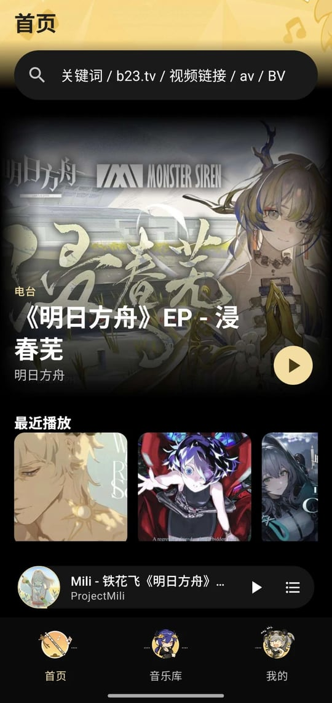
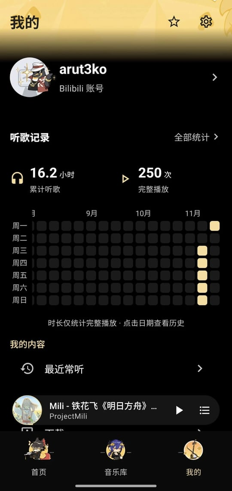
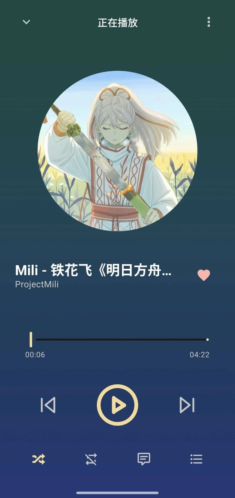
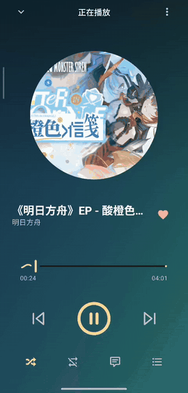

<h1>BBMusica</h1>

Bilibili 向けのサードパーティー製音楽クライアント．
日本語・中国語に対応．

**[ダウンロード ➔ www.aruteko.com/BBmusica](https://www.aruteko.com/BBmusica)**

---

## 画面のプレビュー

<table>
  <tr>
    <th align="center" width="50%">ホーム</th>
    <th align="center" width="50%">ライブラリ</th>
  </tr>
  <tr>
    <td align="center"></td>
    <td align="center"></td>
  </tr>
  <tr>
    <td align="center">ステーション · 最近再生 · 検索欄の選択で履歴を表示</td>
    <td align="center">プレイリスト · お気に入り · コレクション · 分割P</td>
  </tr>
  <tr>
    <th align="center">マイページ</th>
    <th align="center">検索結果</th>
  </tr>
  <tr>
    <td align="center"></td>
    <td align="center"></td>
  </tr>
  <tr>
    <td align="center">アカウント · 再生の統計 · 履歴のヒートマップ</td>
    <td align="center">投稿者・動画の横断検索 · 即時再生</td>
  </tr>
  <tr>
    <th align="center">音楽の再生</th>
    <th align="center">歌詞</th>
  </tr>
  <tr>
    <td align="center"></td>
    <td align="center"></td>
  </tr>
  <tr>
    <td align="center">丸いカバー · 波形のシークバー · いいね</td>
    <td align="center">再生位置への自動追従</td>
  </tr>
  <tr>
    <th align="center" colspan="2">MVの再生</th>
  </tr>
  <tr>
    <td align="center" colspan="2"></td>
  </tr>
  <tr>
    <td align="center" colspan="2">MV視聴可能</td>
  </tr>
</table>

## 主要機能

- **ログイン不要での利用**: 検索，再生，投稿者ページなどの基本機能は，Bilibili へのログインなしで利用可能．
- **ステーション**: 再生履歴を基に，関連性の高い楽曲を自動で選定し，連続再生．
- **プレイリスト**: ローカルのプレイリストに加え，Bilibili のお気に入り・コレクション・分割P動画の同期，外部プレイリストのインポートに対応．
- **MV**: プレーヤー画面を横方向にスワイプすることで，動画を表示．
- **ダウンロード**: 楽曲を端末に保存．
- **外観**: ライト / ダークテーマに対応．Bilibili の装扮（テーマ）の適用が可能．
- **多言語対応**: 日本語・中国語に対応．端末の言語設定に追従し，設定画面からの変更も可能．

## 技術スタック

- **フレームワーク**: React Native，Expo
- **状態管理**: Zustand
- **データ取得**: React Query
- **UI**: Material Design 3（React Native Paper + ExpoUI）
- **再生ライブラリ**: [@bbplayer/orpheus](./packages/orpheus)（Media3 ベース）
- **ORM**: Drizzle ORM

## プロジェクトの構成（モノレポ）

- **[apps/mobile](./apps/mobile)**: BBMusica 本体（モバイルアプリ）のコード．
- **[packages/](./packages)**: 共有ライブラリおよびツール．
  - **[@bbplayer/splash](./packages/splash)**: 歌詞の解析・変換ライブラリ．
  - **[@bbplayer/eslint-plugin](./packages/eslint-plugin)**: プロジェクト固有の lint ルール（oxlint の jsPlugins 経由で実行）．
  - **[@bbplayer/orpheus](./packages/orpheus)**: Media3 ベースの音声再生エンジン．
  - **[@bbplayer/logs](./packages/logs)**: ロギングライブラリ．
  - **[@bbplayer/image-theme-colors](./packages/image-theme-colors)**: 画像（カバー）からのテーマカラー抽出モジュール．
  - **[@bbplayer/native](./packages/native)**: ネイティブ機能の統合モジュール．
  - **[@bbplayer/heatmap](./packages/heatmap)**: SVG ベースの日付ヒートマップコンポーネント．
  - **[expo-wavy-slider](./packages/expo-wavy-slider)**: Jetpack Compose の WavySlider を Expo モジュールとして提供．

## 免責事項

本アプリは，個人が開発した非公式のアプリケーションであり，Bilibili およびその運営会社とは一切関係がない．
利用者は，Bilibili の利用規約および関連法令を遵守するものとする．
本アプリの利用により生じた損害（アカウントの制限・停止を含む）について，開発者は一切の責任を負わない．利用は，利用者自身の責任において行うものとする．
再生されるコンテンツの著作権は，各権利者に帰属する．

## 元になったプロジェクト

BBMusica は，Roitium 氏による **[BBPlayer](https://github.com/bbplayer-app/BBPlayer)** を基に開発した派生アプリケーションである．
優れたプロジェクトを公開された Roitium 氏に，敬意と感謝を表する．

主な変更点は，[NOTICE.md](./NOTICE.md) を参照．

## プライバシー

情報の取り扱いについては，[PRIVACY.md](./PRIVACY.md) を参照．

## ライセンス

本ソフトウェアは MIT ライセンスのもとで公開している．詳細は [LICENSE](./LICENSE) を参照．

---

English

BBMusica is an unofficial Android player for Bilibili music, built on top of
[BBPlayer](https://github.com/bbplayer-app/BBPlayer) by Roitium (MIT).
No account is needed. The UI is available in Japanese and Chinese.
Download: <https://www.aruteko.com/BBmusica>. It is not affiliated with Bilibili.

