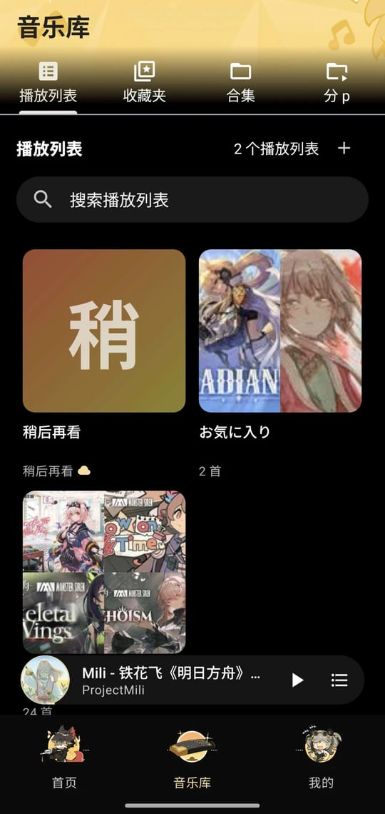
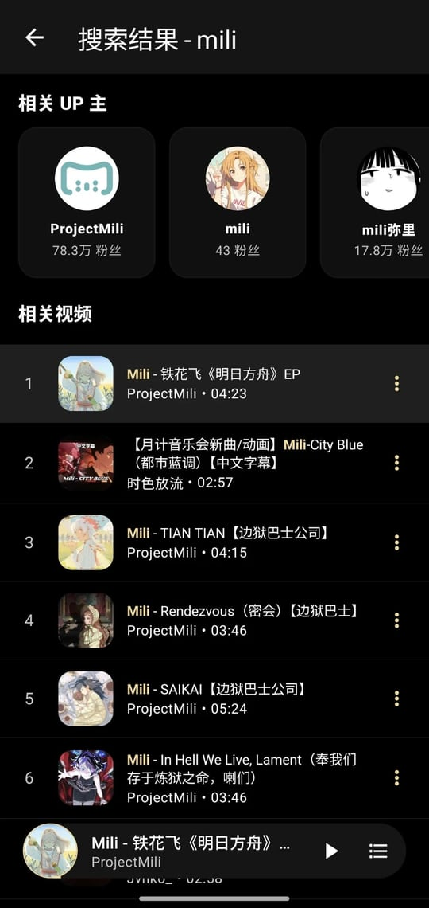
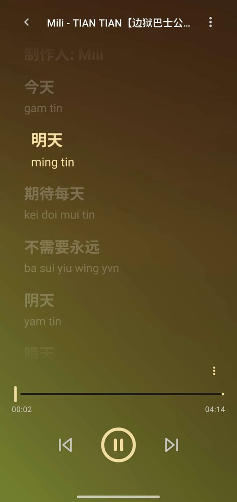

<h1>BBMusica</h1>

BiliBili向けサードパーティー音楽クライアントです．
日本語/中国語対応．

**[ダウンロード ➔ www.aruteko.com/BBmusica](https://www.aruteko.com/BBmusica)**

---

## 画面のプレビュー

<table>
  <tr>
    <th align="center" width="50%">ホーム</th>
    <th align="center" width="50%">ライブラリ</th>
  </tr>
  <tr>
    <td align="center"></td>
    <td align="center"></td>
  </tr>
  <tr>
    <td align="center">ステーション · 最近再生 · 検索欄をタップで履歴</td>
    <td align="center">プレイリスト · お気に入り · コレクション · 分割P</td>
  </tr>
  <tr>
    <th align="center">マイページ</th>
    <th align="center">検索結果</th>
  </tr>
  <tr>
    <td align="center"></td>
    <td align="center"></td>
  </tr>
  <tr>
    <td align="center">アカウント · 再生の統計 · 履歴のヒートマップ</td>
    <td align="center">投稿者と動画をまとめて検索 · すぐ再生</td>
  </tr>
  <tr>
    <th align="center">音楽の再生</th>
    <th align="center">歌詞</th>
  </tr>
  <tr>
    <td align="center"></td>
    <td align="center"></td>
  </tr>
  <tr>
    <td align="center">丸いカバー · 波形のシークバー · いいね</td>
    <td align="center">自動で追従</td>
  </tr>
  <tr>
    <th align="center" colspan="2">MVの再生</th>
  </tr>
  <tr>
    <td align="center" colspan="2"></td>
  </tr>
  <tr>
    <td align="center" colspan="2">MV視聴可能</td>
  </tr>
</table>

## 主要機能

- **ログインなしで使える**: 基本的な機能の利用にはBiliBiliへのログインは不要です．
- **ステーション**: よく聞く曲を起点にし，関連性の高い曲を自動で推薦して流します．
- **プレイリスト**: ローカルのプレイリスト、Bilibili のお気に入り・コレクション・分割P動画の同期、外部プレイリストの取り込みができます。
- **MV**: プレーヤーの画面を横にスワイプして、動画を見られます。
- **ダウンロード**: 曲を端末に保存できます。
- **見た目**: ライト / ダーク、Bilibili の装扮が利用できます．
- **日本語 / 中国語**: 端末の言語に合わせます。設定で切り替えられます。

## 注意

BBMusica は、個人作成の非公式のアプリです。Bilibili とは関係ありません。
Bilibili の利用規約を守って、自分の責任で使ってください。

## 元になったプロジェクト

BBMusica は、Roitium 氏の **[BBPlayer](https://github.com/bbplayer-app/BBPlayer)**をもとに作成しました．
素晴らしいプロジェクトを公開してくださったことに、敬意と感謝を込めて。

変更した主な点は、[NOTICE.md](./NOTICE.md) にまとめています。

## プライバシー

[PRIVACY.md](./PRIVACY.md) を見てください。

## ライセンス

MIT ライセンスです。[LICENSE](./LICENSE) を見てください。

---

English

BBMusica is an unofficial Android player for Bilibili music, built on top of
[BBPlayer](https://github.com/bbplayer-app/BBPlayer) by Roitium (MIT).
No account is needed. The UI is available in Japanese and Chinese.
Download: <https://www.aruteko.com/BBmusica>. It is not affiliated with Bilibili.

